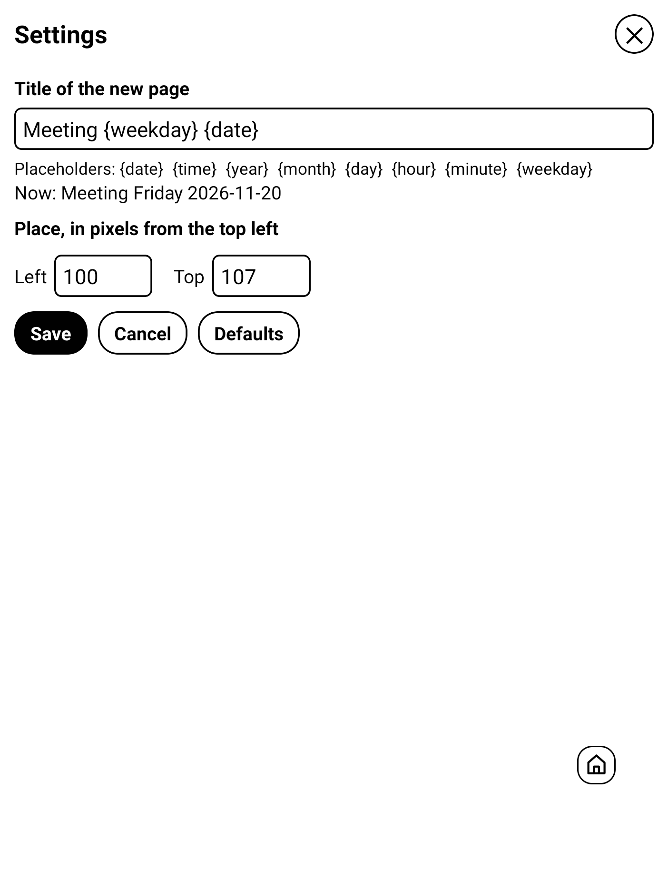
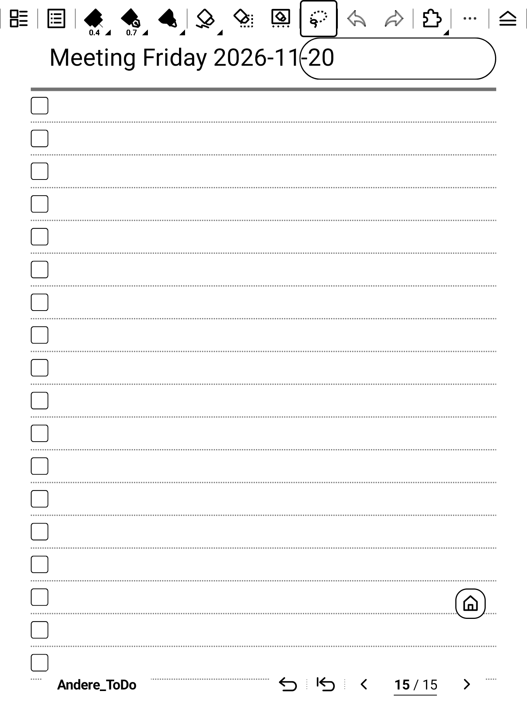

<p align="center">
  
</p>

<h1 align="center">SNAddPage</h1>

<p align="center">
  <b>Turn a line in your notes into a link to a fresh meeting page.</b>
</p>

<p align="center">
  
  
  
</p>

A plugin for **Supernote** e-ink devices (Nomad, Manta, A5X, A6X). Select a few words
in a note with the lasso, tap **Add meeting**, and pick a notebook. The plugin adds a
page at the end of that notebook, writes a header such as `Meeting 2026-11-20` at the
top, and turns your selection into a link to that page.

Handy for an agenda or a to-do list: write the topic, link it to a page in your
meetings notebook, and take the notes there.

Built with the official Supernote plugin SDK
([`sn-plugin-lib`](https://docs.supernote.com/en)) on React Native 0.79.2.

> [!NOTE]
> For now this plugin is only tested on a **Supernote Nomad (A6X2)**. It should work on
> the other models, but the place and size of the header may need tuning there.
> Feedback from other devices is welcome.

<table>
  <tr>
    <td align="center"><br><sub><b>Settings</b>: title and place</sub></td>
    <td align="center"><br><sub>The <b>new page</b>, on the notebook's own template</sub></td>
  </tr>
</table>

---

## Features

- **One tap from the lasso**: select handwriting or a text box, and *Add meeting* is in
  the lasso toolbar.
- **Any notebook**: all notes in the `Note` folder, with the open note on top and the
  one you picked last right below it. The open note itself works too.
- **Same paper**: the new page gets the template of the last page, also when that is
  your own template from `MyStyle`.
- **Dated header**: `Meeting YYYY-MM-DD` (today, in the device's time) as a text box at
  the top left, and as a keyword, so the meeting shows up in the keyword list of the note.
- **Your own header**: under *Settings*, type your own title with placeholders for the
  date and time, and choose where it goes on the page.
- **A real link**: your selection becomes a Supernote link (solid underline) to the new
  page. It keeps pointing to that page when you add pages before it later.
- **Clear when something fails**: you see which step failed and what was already done,
  so nothing changes behind your back.
- **Made for e-ink**: black and white, large touch targets, no animations.

## Installation

1. Download `SNAddPage.snplg` from the
   [latest release](https://github.com/Vampie/SNAddPage/releases/latest),
   or build it yourself (see [Building from source](#building-from-source)).
2. Connect the Supernote by USB and copy the `.snplg` file to the **`MyStyle`** folder.
3. On the device, go to **Settings → Apps → Plugins → Add Plugin**, pick the file and
   install it.
4. Open a note and select something with the lasso: **Add meeting** is now in the lasso
   toolbar.

The first time, the device asks permission to read and to change your notes. Allow it
to go on.

To update, install the new package the same way. It replaces the old version.

## Using it

1. In a note, select a few words with the **lasso**: handwriting, or one text box.
2. Tap **Add meeting** in the lasso toolbar.
3. Tap the notebook that gets the meeting page. `✕` closes the list without changing
   anything.
4. The plugin closes. Your selection is now a link: tap it to go to the new page.

What happens to the chosen notebook:

| | |
| --- | --- |
| New page | Added after the last page, with the template of that last page. |
| Header | The title from *Settings* (default `Meeting 2026-11-20`) as a text box at the place from *Settings*. |
| Keyword | The same text, on the new page. |
| Link | Your selection points to the new page. |

### Settings

Tap **Settings** at the top of the notebook list.

| Field | What it does |
| --- | --- |
| Title of the new page | Text with placeholders, filled in with the device's date and time when you add a page. Under the field, *Now:* shows what it gives right now. |
| Left, Top | Where the header starts, in pixels from the top left corner of the page. A header that would not fit is moved back onto the page. |

| Placeholder | Becomes | Placeholder | Becomes |
| --- | --- | --- | --- |
| `{date}` | `2026-11-20` | `{day}` | `20` |
| `{time}` | `14:05` | `{hour}` | `14` |
| `{year}` | `2026` | `{minute}` | `05` |
| `{month}` | `11` | `{weekday}` | `Friday` |

For example `Overleg {weekday} {day}/{month} {time}` gives `Overleg Friday 20/11 14:05`.
**Save** keeps the settings, **Cancel** leaves them as they were, and **Defaults** fills in
`Meeting {date}` at 100, 107 (save to keep).

> [!TIP]
> A text box with a link on it is no longer editable: a tap follows the link. That is how
> the Supernote handles links. Remove the link to edit the text, then add it again.

When a step fails, the plugin stays open and shows the step and the device's answer,
plus the steps that were already done. Nothing is undone automatically: if the page was
already added, delete it yourself or use undo in the note.

## Limitations

- **Only the `Note` folder** is listed (with its subfolders), plus the open note. Notes on
  an SD card or a USB stick are not.
- **No real title**: plugins can only make a title from handwriting in the open note, so
  the header is a text box plus a keyword. It does not appear in the title list.
- **Your own templates** must still be in `MyStyle`; otherwise the new page is blank and
  the plugin tells you so.
- **Placeholders are case sensitive** (`{Date}` stays as typed), and `{weekday}` is always
  in English.
- **Settings live on the device**, in the plugin's own folder. After reinstalling the
  plugin you may have to set them again.
- **Full screen only**: the SDK has no floating or smaller plugin window.
- **Only tested on a Supernote Nomad (A6X2)** so far.

## Building from source

You need [Node.js](https://nodejs.org) 18 or newer and npm. No Android SDK or JDK is
needed: this is a pure JavaScript plugin.

```bash
npm install
npm test               # helper tests (jest)
npm run typecheck
npm run lint
npm run build:plugin   # → build/outputs/SNAddPage.snplg
```

`npm run build:plugin` runs the official `buildPlugin.ps1` (PowerShell). On macOS or
Linux, run `./buildPlugin.sh` instead.

For every new build you install on a device, raise `versionCode` and `versionName` in
`PluginConfig.json`. Never change `pluginID`: the device would see it as a different
plugin.

## Project structure

```
├── index.js              Plugin entry: lasso toolbar button and its listener
├── App.tsx               UI: note list, settings, progress, errors
├── src/
│   ├── addMeeting.ts     The flow: list notes, add the page, header, keyword, link
│   ├── meeting.ts        Pure helpers: placeholders, settings, list order, folder scan, header box, template names
│   ├── settings.ts       Saves and loads the settings
│   └── presses.ts        Passes button presses from index.js to the UI
├── __tests__/            Jest tests for the helpers
├── PluginConfig.json     Plugin name, version and permissions
└── buildPlugin.ps1/.sh   Official Supernote packaging scripts
```

## Notes for plugin developers

Found while building this, with `sn-plugin-lib` 0.1.65 on a Nomad:

- `FileUtils.getFileList` makes PluginHost crash: the plugin view flashes and closes, and
  the next button press is lost while PluginHost restarts. Its native code calls
  `getCurrentActivity()` without a null check (as do `getImageList` and
  `getExternalDirPath`). `FileUtils.listFiles(dir)` works; it returns
  `[{path, type: 0 folder | 1 file}]` or `null`, not the `string[]` its types say.
- Register `registerButtonListener` in `index.js`, right after `registerButton`. A
  listener registered in the UI's `useEffect` never got the press here.
- Linking first (to the page about to be added) failed with the lasso gone by then; the
  exact cause is unknown. Adding the page first and linking last works.
- For a custom template, `getNotePageTemplate` returns `{name: "user_<file>", md5:
  "<md5>_<number>"}`, and `insertNotePage` refuses that name with
  `802: Background template file does not exist!`. The plugin then tries the template
  image from `MyStyle` (found by file name or by the md5 part), then the file name
  without `user_`. One of those works; which one is not logged.
- `setLassoStrokeLink` also works on a text box in the lasso.
- The SDK has no storage API and cannot write file contents. The settings are kept as
  the **name of a folder** in `PluginManager.getPluginDirPath()`
  (`settings/s1_<encodeURIComponent(JSON)>`): `FileUtils.makeDir`, `listFiles` and
  `deleteDir` work there without any permission.
- A React Native `TextInput` works in a plugin view: the device keyboard comes up.

## Permissions

| Permission | Why |
| --- | --- |
| `plugin.permission.FILE:READ` | To list your notes, read the selection and find your template in `MyStyle`. |
| `plugin.permission.FILE:WRITE` | To add the page, the header, the keyword and the link. |

The plugin only touches the note you are in and the note you pick, and does not use the
internet.
